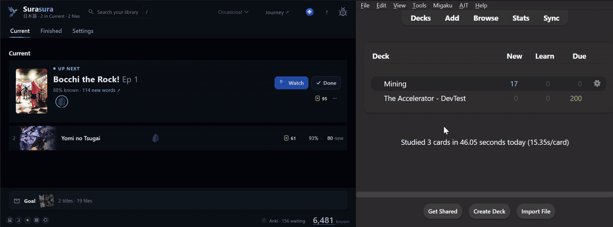
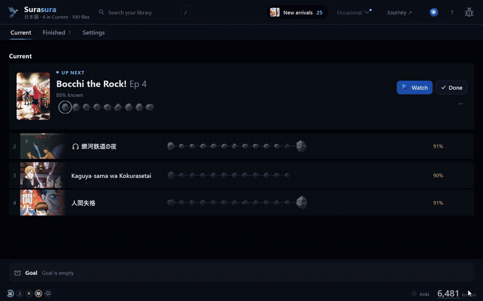
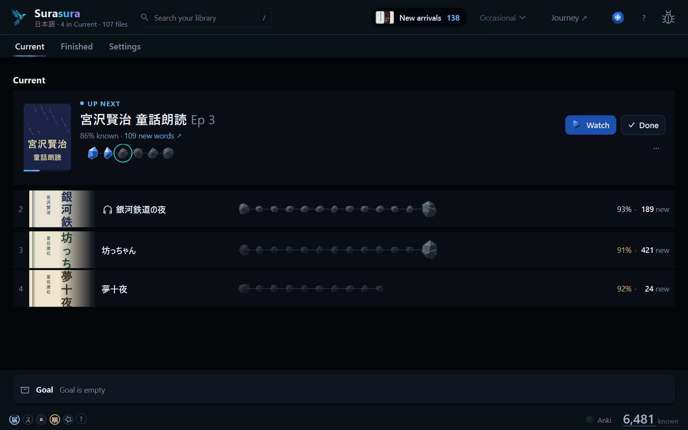
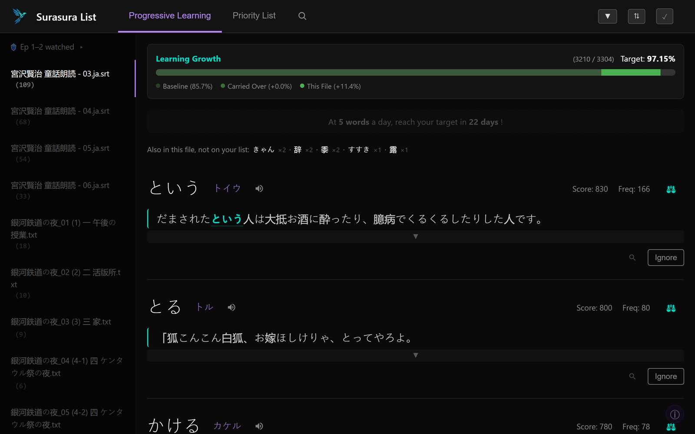
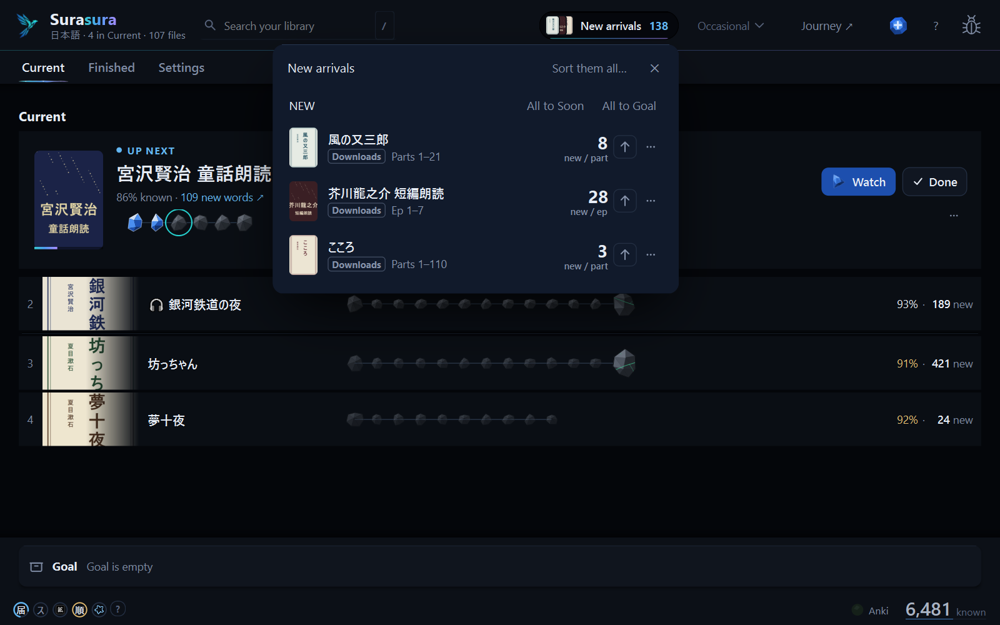

<div align="center">


# Surasura スラスラ

    [](https://discord.gg/Uy8mHymrRv)

**The only frequency list that matters is the one made from your own shows and books.**

**Point it at your content folder. It works out the rest:** series, books, episodes, covers and order.

</div>

<div align="center">



[▶ The same clip (MP4, 18 s)](docs/assets/images/readme/anki.mp4)



[▶ Full demo (MP4, 45 s)](docs/assets/images/readme/demo.mp4)

</div>

## What it does

| Your library, in your order | The words worth learning next |
| :---: | :---: |
|  |  |
| Each row is a show or a book. **% known** and **new words** are worked out from your own known words. | The words that open up the most of your shows and books, episode by episode, each with a sentence from your library. |
|  |  |
| New episodes, books and videos **arrive by themselves**. Drag one into your order, or press ↑. | **Mine** makes the cards with Anki Miner, and Anki shows them in your order. |

**Also:** **Piyo ぴよ** lets you practise with your own AI app, on your own words.

## What it reads

| 📺 Subtitles | 📖 Books | 🎧 Audiobooks | ▶️ YouTube · bilibili | 📝 Text | 🗂️ Anki decks |
| :---: | :---: | :---: | :---: | :---: | :---: |
| `.srt` `.ass` `.ssa`, named the way releases name them (`.ja`, `.ab`, `[jpn]`…) | EPUB, split by chapter | `.m4b` `.mp3` `.m4a`… with their transcript, joined to their book when there is one | A video's subtitles, from its link | `.txt` `.md`, or pasted | A deck's sentences (`.apkg`) |

Japanese and Chinese.

| A book opens by chapter |
| :---: |
|  |

## Get started

1. **Point it at your content folder.** Setup asks *Where are your shows and books?* It finds your shows, books (EPUB)
   and audiobooks where they are, and works out their series, episodes and order. Nothing is moved. Covers come from
   AniList when you turn on *Show covers*.
2. **Tell it what you know.** Your Anki decks, Jiten, Migaku, or an Anki deck file (`.apkg`).
   *Surasura talks to Anki through **AnkiConnect**, a free Anki add-on. On Windows, setup's **Install AnkiConnect for
   me** gets it from AnkiWeb and adds it while Anki is closed. Or in Anki: Tools › Add-ons › Get Add-ons…, paste the
   code `2055492159` (setup's **Copy code** puts it on your clipboard), then restart Anki.*
3. **Sort what it found.** One title at a time, one key each: **Soon (S) · Current (→) · Goal (↓) · Finished (↑) ·
   Ignore (←)**. Not sure yet? Leave the rest in **New arrivals** and sort them later.
4. **Watch and read in order.** **Current** is your order: **Up Next** on top, then Soon, and **Goal** (someday) at its
   foot. Drag a show to move it. Check an episode's stone when you've watched it, and its words leave your list.
5. **Learn the words.** *Generate* builds your list; **Journey ↗** opens it: each episode's new words, each with a
   sentence from your library. **Mine** makes the cards with Anki Miner, and Anki shows them in your order.

*(Nothing of your own yet? Setup's **Try it with samples first** puts a few samples in.)*

## Download

| You have | Get |
| :--- | :--- |
| Windows 10 or 11 | `Surasura-<version>-setup.exe` from the [Releases page](https://github.com/SonicSandbox/surasura/releases) |
| Surasura 2.x | The same installer: it brings your known words, word lists and settings over |

> **Coming from a 2.9 test build?** 3.0 sets up once more: your library order, watched / Finished marks and journey don't carry over. Your known words come back with your first Anki sync. On a PC where Surasura 2.x once ran, 3.0's first screen also offers to bring your word lists and settings from it.

New to the window? The [guide](docs/Tutorial.md) shows it in a few minutes.

<details>
<summary>🛠️ Running from source</summary>

1. Python 3.10 or higher.
2. Clone the repository: `git clone https://github.com/SonicSandbox/surasura.git`
3. Install dependencies:
   ```bash
   pip install -r requirements.txt
   ```
4. Run the master entry point:
   ```bash
   python app_entry.py
   ```

To build your own standalone program: `pip install pyinstaller`, then `python package_app.py` (it runs the test suite,
then PyInstaller, into `dist/Surasura/`; `--zip` also makes `dist/Surasura_v<version>.zip`). See
[README_PACKAGING.md](README_PACKAGING.md) for the release options.

</details>

## 🗺️ Roadmap

**Next**
- Faster with huge libraries
- Smoother YouTube downloads when YouTube asks "are you a bot?"

**Soon**
- Anki cards made only when you need them, even with Anki closed
- The journey: replay a line where it was said, swap sentences, mark words from the page
- Manga support
- Everything you've finished, on one wall

**Later**
- 34+ languages to learn
- Surasura in your language
- Mac and Linux
- Profiles, one per language
- Full themes

Ideas? Tell us on [Discord](https://discord.gg/Uy8mHymrRv).

## ❓ Q&A / FAQ

If you have any questions or are running into issues, please check out the [Q&A / FAQ Guide](https://github.com/SonicSandbox/surasura/blob/main/docs/Surasura%20FAQ.md). Still stuck, or just want to talk? Join us on [Discord](https://discord.gg/Uy8mHymrRv).

Wondering why a word on your list or your card is cut the way it is? [How Parsing Works](https://github.com/SonicSandbox/surasura/blob/main/docs/How%20Parsing%20Works.md) shows, on one page, what Surasura counts as one word, with examples — it also opens from **Settings → Language & Parsing → How parsing works**.

## 🤝 Support & Issues

Encountered a bug or have a feature request? Please search the [Issues](https://github.com/SonicSandbox/surasura/issues) page to see if it's already being worked on. If not, feel free to open a new issue.

In the app, the bug at the top right (**Report a problem**) gathers what's needed to look into it; **Send report** shows you exactly what goes, with your Windows name and folders taken out, then sends it to Sonic privately (kept 90 days; [what leaves your computer](https://github.com/SonicSandbox/surasura/blob/main/docs/Surasura%20FAQ.md)). **Make a zip instead** keeps it on your PC, to post on Discord or attach to an issue here.

## 💡 Motivation
*I was tired of learning words I never see, and I also like reading physical books. Otherwise, mining from physical books is a pain.* Surasura solves that friction.

Surasura 2.x's README: [docs/legacy/README_2.x.md](docs/legacy/README_2.x.md).

## 📂 Your content

Surasura provides no content. It works only with what you give it: your own subtitles, videos, books, audiobooks,
texts, word lists and Anki decks, and anything you get with the tools and sites it can open or call (YouTube and
bilibili through yt-dlp, jimaku, Anki Miner). **You are responsible for the content you use with Surasura:** use only
content you own or have the right to use, and follow the law and the terms of the sites and services you get it from.
Surasura does not host or share your content: it stays on your computer, except what you choose to send: to a service
you connect, or in a problem report you send. The installer asks you to accept this, with the licence below.

## 🙏 Credits

The dictionaries, tokenizers and data Surasura is built on: [Credits](docs/CREDITS.md).

## 📜License

Distributed under the MIT License. See `LICENSE` for more information.
