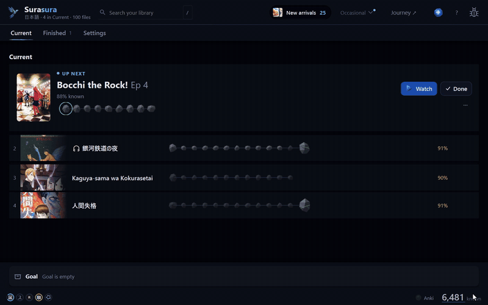
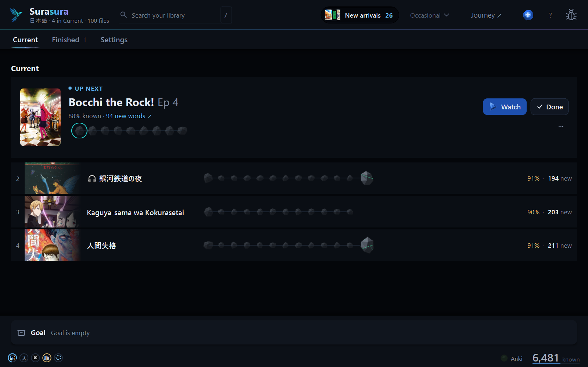
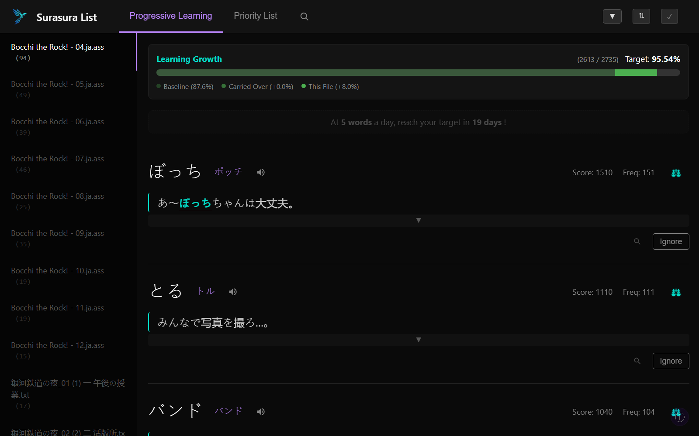
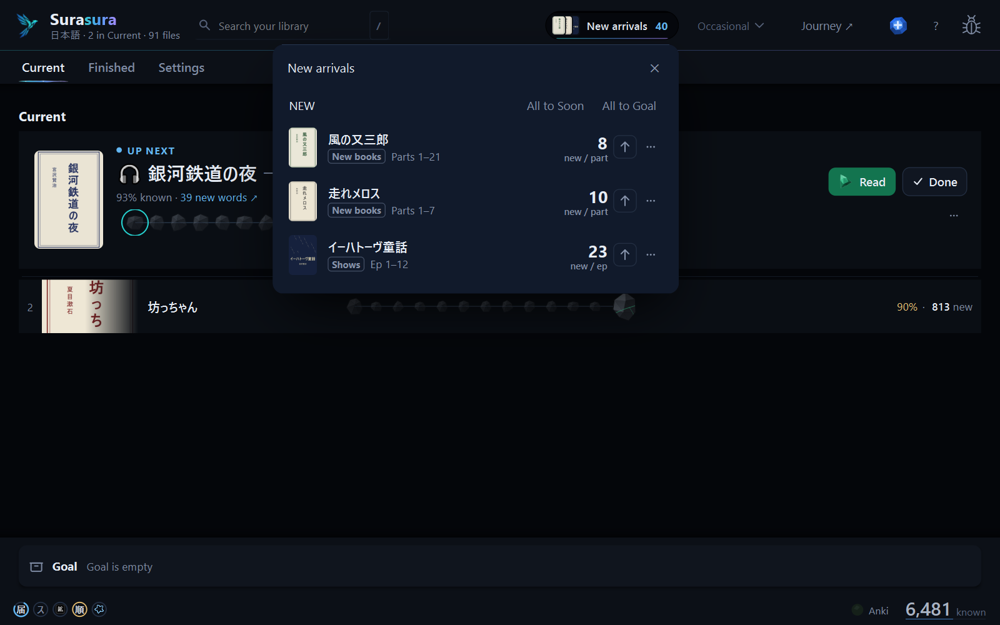
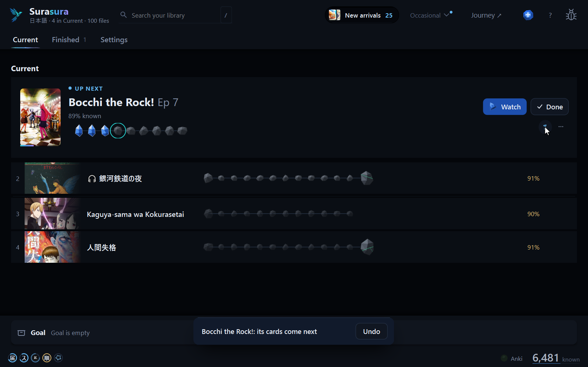
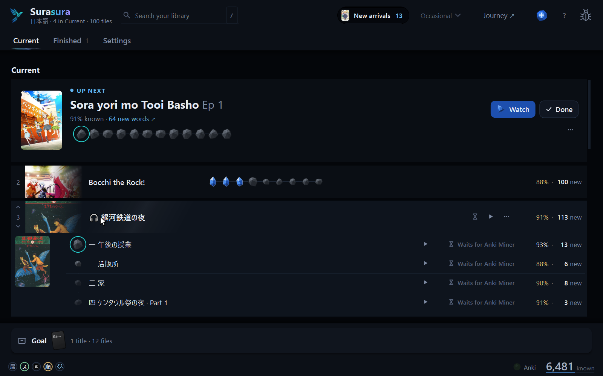

<div align="center">


# Surasura スラスラ

    [](https://discord.gg/Uy8mHymrRv)

**The only frequency list that matters is the one made from your own shows and books.**

**Point it at your content folder. It works out the rest:** series, books, episodes, covers and order.

</div>

<div align="center">



[▶ Full demo (MP4, 45 s)](docs/assets/images/readme/demo.mp4)

</div>

## What it does

| Your library, in your order | The words worth learning next |
| :---: | :---: |
|  |  |
| Each row is a show or a book. **% known** and **new words** are worked out from your own known words. | The words that open up the most of your shows and books, episode by episode, each with a sentence from your library. |
|  |  |
| New episodes, books and videos **arrive by themselves**. Drag one into your order, or press ↑. | **Mine** makes the cards with Anki Miner, and Anki shows them in your order. |

**Also:** **Piyo ぴよ** lets you practise with your own AI app, on your own words.

## What it reads

| 📺 Subtitles | 📖 Books | 🎧 Audiobooks | ▶️ YouTube · bilibili | 📝 Text | 🗂️ Anki decks |
| :---: | :---: | :---: | :---: | :---: | :---: |
| `.srt` `.ass` `.ssa`, named the way releases name them (`.ja`, `.ab`, `[jpn]`…) | EPUB, split by chapter | `.m4b` `.mp3` `.m4a`… with their transcript, joined to their book when there is one | A video's subtitles, from its link | `.txt` `.md`, or pasted | A deck's sentences (`.apkg`) |

Japanese and Chinese.

| A book opens by chapter |
| :---: |
|  |

## Get started

1. **Point it at your content folder.** Setup asks *Where are your shows and books?* It finds your shows, books (EPUB)
   and audiobooks where they are, and works out their series, episodes and order. Nothing is moved. Covers come from
   AniList when you turn on *Show covers*.
2. **Tell it what you know.** Your Anki decks, Jiten, Migaku, or an Anki deck file (`.apkg`).
   *Surasura talks to Anki through **AnkiConnect**, a free Anki add-on: in Anki, Tools › Add-ons › Get Add-ons…, paste
   the code `2055492159` (setup's **Copy code** puts it on your clipboard), then restart Anki.*
3. **Sort what it found.** One title at a time, one key each: **Soon (S) · Current (→) · Goal (↓) · Finished (↑) ·
   Ignore (←)**. Not sure yet? Leave the rest in **New arrivals** and sort them later.
4. **Watch and read in order.** **Current** is your order: **Up Next** on top, then Soon, and **Goal** (someday) at its
   foot. Drag a show to move it. Check an episode's stone when you've watched it, and its words leave your list.
5. **Learn the words.** *Generate* builds your list; **Journey ↗** opens it: each episode's new words, each with a
   sentence from your library. **Mine** makes the cards with Anki Miner, and Anki shows them in your order.

*(Nothing of your own yet? Setup's **Try it with samples first** puts a few samples in.)*

## Download

| You have | Get |
| :--- | :--- |
| Windows 10 or 11 | `Surasura-<version>-setup.exe` from the [Releases page](https://github.com/SonicSandbox/surasura/releases) |
| Surasura 2.x | The same installer: it brings your known words, word lists and settings over |

> **Coming from a 2.9 test build?** 3.0 sets up once more: your library order, watched / Finished marks and journey don't carry over. Your known words come back with your first Anki sync. On a PC where Surasura 2.x once ran, 3.0's first screen also offers to bring your word lists and settings from it.

New to the window? The [guide](docs/Tutorial.md) shows it in a few minutes.

<details>
<summary>🛠️ Running from source</summary>

1. Python 3.10 or higher.
2. Clone the repository: `git clone https://github.com/SonicSandbox/surasura.git`
3. Install dependencies:
   ```bash
   pip install -r requirements.txt
   ```
4. Run the master entry point:
   ```bash
   python app_entry.py
   ```

To build your own standalone program: `pip install pyinstaller`, then `python package_app.py` (it runs the test suite,
then PyInstaller, into `dist/Surasura/`; `--zip` also makes `dist/Surasura_v<version>.zip`). See
[README_PACKAGING.md](README_PACKAGING.md) for the release options.

</details>

## 🗺️ Roadmap

**Next**
- Start over or sort again, with Put back
- One-press private bug reports
- Airing shows stay open until the season ends
- Faster with huge libraries

**Soon**
- Anki cards made only when you need them
- The journey: replay a line where it was said, swap sentences, mark words from the page
- Manga support
- A guided setup for the automation

**Later**
- 34+ languages to learn
- Surasura in your language
- Mac and Linux
- Profiles, one per language
- Full themes

Ideas? Tell us on [Discord](https://discord.gg/Uy8mHymrRv).

## ❓ Q&A / FAQ

If you have any questions or are running into issues, please check out the [Q&A / FAQ Guide](https://github.com/SonicSandbox/surasura/blob/main/docs/Surasura%20FAQ.md). Still stuck, or just want to talk? Join us on [Discord](https://discord.gg/Uy8mHymrRv).

Wondering why a word on your list or your card is cut the way it is? [How Parsing Works](https://github.com/SonicSandbox/surasura/blob/main/docs/How%20Parsing%20Works.md) shows, on one page, what Surasura counts as one word, with examples — it also opens from **Settings → Language & Parsing → How parsing works**.

## 🤝 Support & Issues

Encountered a bug or have a feature request? Please search the [Issues](https://github.com/SonicSandbox/surasura/issues) page to see if it's already being worked on. If not, feel free to open a new issue.

In the app, the bug at the top right (**Report a problem**) makes a zip of what's needed to look into it; **Send on Discord** shows the zip and opens the server: drop it in the bug-report channel, or attach it to an issue here.

## 💡 Motivation
*I was tired of learning words I never see, and I also like reading physical books. Otherwise, mining from physical books is a pain.* Surasura solves that friction.

Surasura 2.x's README: [docs/legacy/README_2.x.md](docs/legacy/README_2.x.md).

## 🙏 Data Credits

Surasura's shared パターン data for Japanese is built from:

- [RealPersonaChat](https://github.com/nu-dialogue/real-persona-chat) — Yamashita et al. (2023), CC BY-SA 4.0
- [Aozora Bunko](https://www.aozora.gr.jp/) — public-domain works, via [aozorabunko-clean](https://huggingface.co/datasets/globis-university/aozorabunko-clean) (CC BY 4.0)
- [Japanese Wikipedia](https://ja.wikipedia.org/) — Wikipedia contributors, CC BY-SA 4.0
- [Leipzig Corpora Collection](https://wortschatz.uni-leipzig.de/) — Japanese news 2015–2019, Universität Leipzig, CC BY 4.0 (counts only)

…and for Chinese from:

- [Tatoeba](https://tatoeba.org/) — Mandarin sentences, CC BY 2.0 FR
- [KdConv](https://github.com/thu-coai/KdConv) — Zhou et al. (2020), film and music conversations, Apache License 2.0
- [Chinese Wikipedia](https://zh.wikipedia.org/) — Wikipedia contributors, CC BY-SA 4.0
- [Chinese Wikinews](https://zh.wikinews.org/) — 维基新闻 contributors, CC BY 4.0
- [Leipzig Corpora Collection](https://wortschatz.uni-leipzig.de/) — Chinese news 2007–2009 and 2020, Traditional newscrawl 2011, Universität Leipzig, CC BY 4.0 (counts only)

The data itself is shared under [CC BY-SA 4.0](https://creativecommons.org/licenses/by-sa/4.0/).

The kanji names Surasura keeps whole as one word (Settings → Language & Parsing → "Kanji names (JMnedict)") come from
[JMnedict](https://www.edrdg.org/enamdict/enamdict_doc.html), the Japanese proper-names dictionary of the JMdict/EDICT
project, property of the [Electronic Dictionary Research and Development Group](https://www.edrdg.org/edrdg/licence.html),
used under [CC BY-SA 4.0](https://creativecommons.org/licenses/by-sa/4.0/) — by way of the name lists in
[anki_miner](https://github.com/0xzerolight/anki_miner). Only the spellings of surnames and given names are kept; that
table (`app/name_data.py`) is shared under the same licence.

Which compounds are set phrases or titles (Settings → Language & Parsing → "Phrases and titles as one word"),
which お / ご words have a meaning of their own (お守り, お帰り), and which words the tokenizer cuts at their grammar are
words of their own (くだらない, 知らせる, いつも, ちなみに) comes from
[JMdict](https://www.edrdg.org/jmdict/j_jmdict.html), the Japanese–multilingual dictionary of the same project, property
of the [Electronic Dictionary Research and Development Group](https://www.edrdg.org/edrdg/licence.html), used under
[CC BY-SA 4.0](https://creativecommons.org/licenses/by-sa/4.0/), and from JMnedict's names of works, products and
organizations. Only marks on spellings, and those words' spellings and readings, are kept (no meanings); that table
(`app/dictionary_data.py`) is shared under the same licence.
JMdict's kanji spellings, entry by entry, and the readings of the entries a card can end in — no meanings — keep "A work’s
own terms" from ever joining a word the dictionary lists, and tell which word an Anki card
is (心する 'take heed' is a word of its own, not 心); that table (`app/jmdict_data.py`) is shared under the same licence
too. So are the set phrases Surasura can add to your list (Settings → Language & Parsing → "Idioms as
rows"): JMdict's phrases as the tokenizer reads them — lemmas, readings, a spelling to show, no meanings — with
which of their words live only inside them (by JPDB 2024's ranks) and which are units in general text (counted, as
statistics only, on the shared パターン set's Japanese text above); that table (`app/phrase_data.py`) is shared under
the same licence. So is the list of one-kanji words Surasura can offer (Settings → Language & Parsing → "List one-kanji
words only when they're dictionary words": 手, 顔, こと): the one-character words that JMdict lists with their reading
and calls common — or that JPDB 2024 and Jiten both rank among their top 20,000 — and that general text (the same
shared set's Japanese text, as statistics only) uses as words of their own; that table (`app/one_kanji_data.py`) keeps
only spellings and readings.
Whether two words that meet are one compound or only a coincidence is also counted, as statistics only, on the
[Leipzig Corpora Collection](https://wortschatz.uni-leipzig.de/)'s Japanese web text (Universität Leipzig, CC BY 4.0).

The Chinese words Surasura reads as one — the numbers and doubled forms it counts as their word, the names it keeps
by their surnames, and the Traditional spellings it reads as their Simplified pair (睡著 as 睡着) — come from
[CC-CEDICT](https://cc-cedict.org/wiki/) (MDBG,
[CC BY-SA 4.0](https://creativecommons.org/licenses/by-sa/4.0/)) and the
[Universal Dependencies](https://universaldependencies.org/) Chinese treebanks (GSDSimp, HK and CFL, CC BY-SA 4.0);
only spellings are kept, in `app/cedict_data.py` and among `app/zh_script_data.py`'s phrases, shared under the same
licence.

With *Download covers* on (off until you say yes), the 3.0 window shows each show's cover from
[AniList](https://anilist.co) (asked by the show's AniList id, or its cleaned name), and a video's own thumbnail from
[YouTube](https://www.youtube.com); nothing is shipped, and *Remove downloaded covers* deletes them.

The same credits, with the frequency lists and the tokenizers' dictionaries (UniDic, jieba, OpenCC), are in the app:
Settings → App → Data credits.

## 📜License

Distributed under the MIT License. See `LICENSE` for more information.
