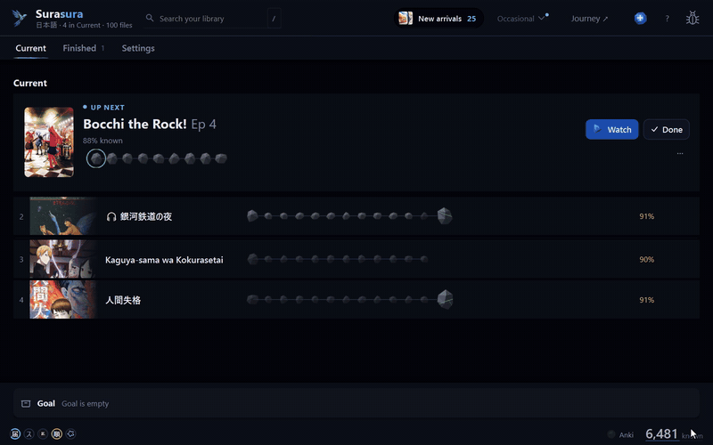
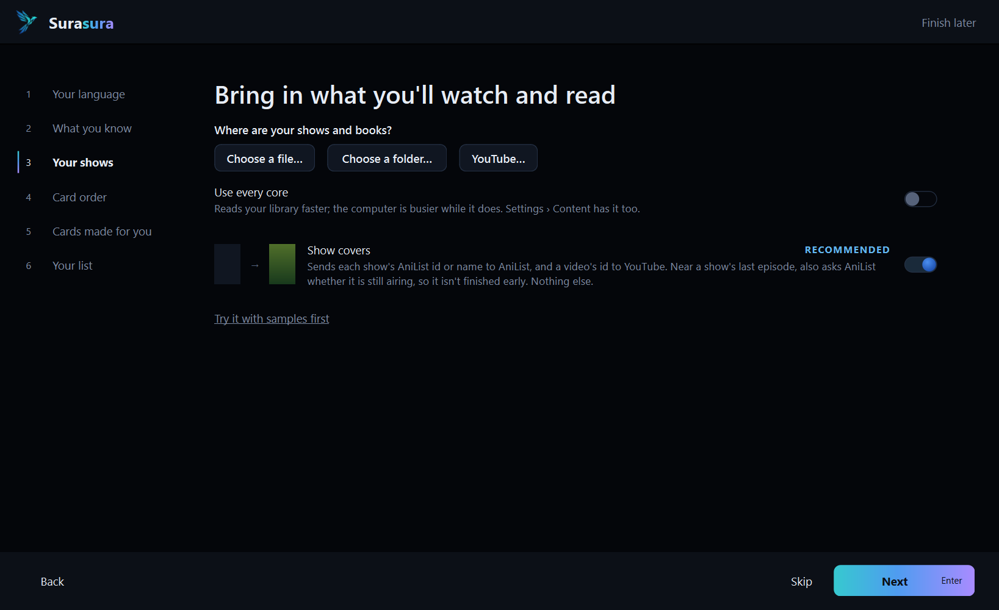
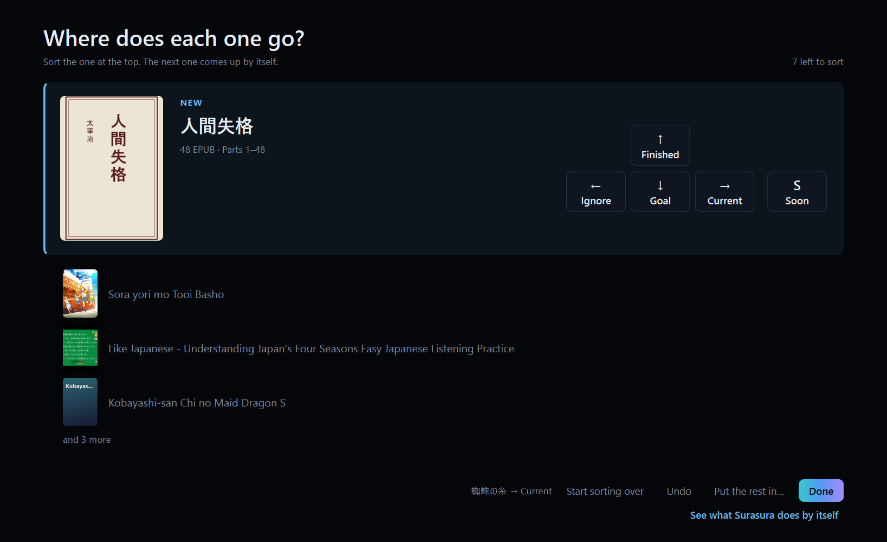
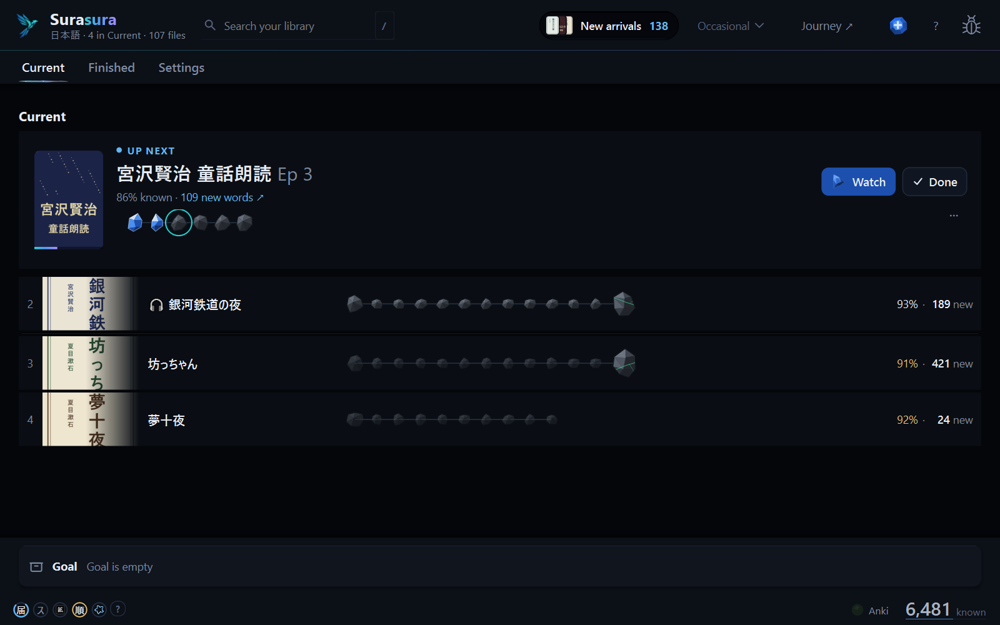
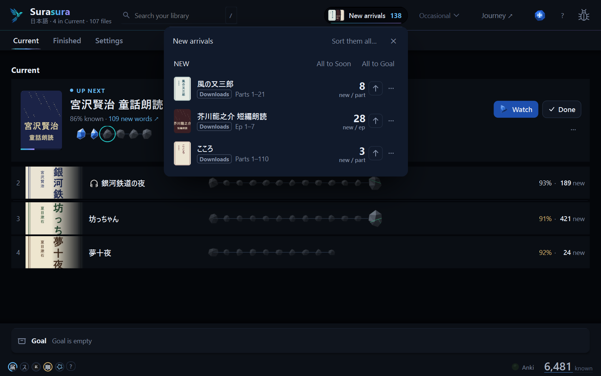
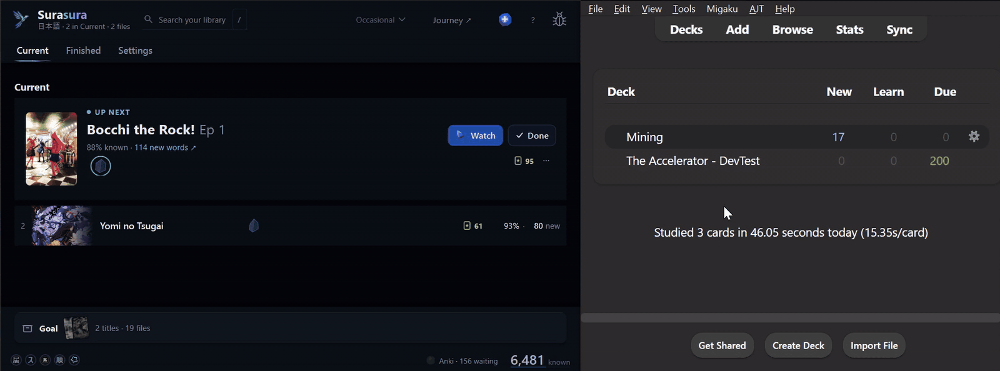
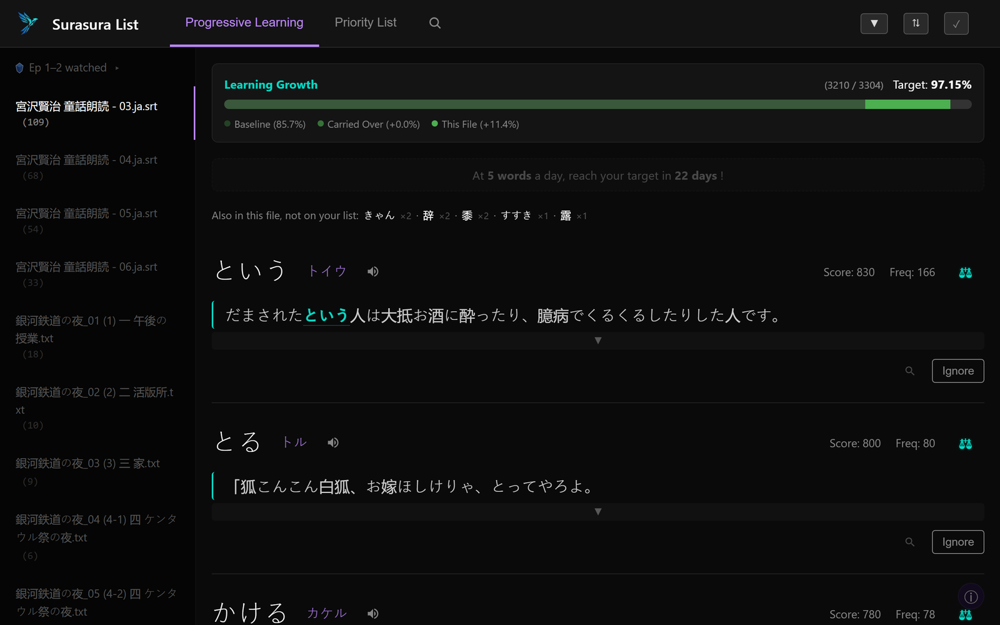
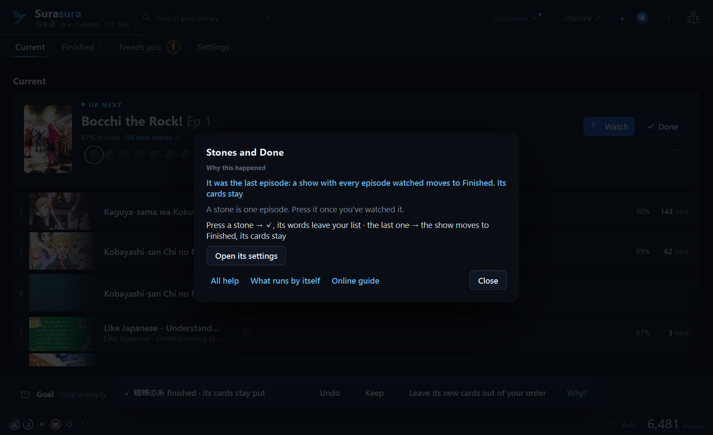
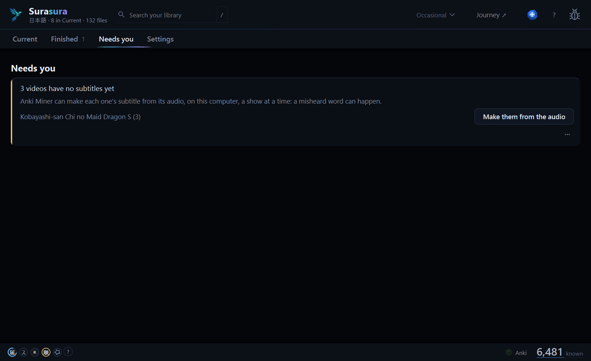

# Surasura 3.0 — a new Surasura

**Point it at your shows and books. It works out the rest, then makes your cards in your order.**

[▶ Full demo (45 s)](https://raw.githubusercontent.com/SonicSandbox/surasura/v3.0.0/docs/assets/images/readme/demo.mp4) · [Download `Surasura-3.0.0-setup.exe`](#download) · [Coming from 2.5?](#coming-from-25)

## 1 · Point it at your folders

| Where are your shows and books? | Then one key for each title |
| :---: | :---: |
|  |  |
| Pick the folders they're in. | Sort each title with one key; the next comes up by itself. |

Shows, books and audiobooks are read **where they already are** — nothing is copied or moved. Series, seasons,
episodes and covers are worked out from the file names. Then sort each title with one key: **Soon · Current · Goal ·
Finished · Ignore**.

## 2 · One window, in your order

| Your library, in your order | New episodes arrive by themselves |
| :---: | :---: |
|  |  |
| **Current** is your order: Up Next on top, Soon, then Goal. Drag to move. | New episodes, books and YouTube videos wait in **New arrivals**: drag one in, or press ↑. |

Check an episode's stone when you've watched it and its words leave your list. One **Undo** for everything.

## 3 · Your cards make themselves

Place an episode and **Anki Miner makes its cards** — each word cut from its own line, one speaker's sentence (a short one kept as it
is), never longer than 8 seconds. **Move a show and Anki's order follows at once.** Surasura installs and sets up Anki Miner for you,
and adds AnkiConnect if it's missing.

| Mine an episode | Books and audiobooks too |
| :---: | :---: |
|  |  |
| Cards come in the order you'll watch. | Books split by chapter; a book with its audiobook gets the narrator's voice on every card. |

## 4 · The words worth learning next

**Journey ↗** opens at once: each episode's new words, with a sentence from your own library. Grammar expressions
(かもしれない, として) and Kansai (やってへん, あかん) read as words; 言い方 and 私生活 stay whole; a set phrase
shows as your library writes it (ごめんなさい), and a line shown again counts once.

## 5 · It tells you what it's doing

| Why? on what it did by itself | One card for each decision |
| :---: | :---: |
|  |  |
| A toast's **Why?** opens its help card, the reason on top. | **Needs you**: *Make them from the audio*. |

Press **?** on any screen for what it does. Anything Surasura does by itself has a **Why?**. Decisions wait in
**Needs you**, one card each. Found a bug? **Report a problem → Send report**, privately, with your name and folders
taken out.

Also new: **Piyo ぴよ** (practise with your own AI app, on your own words) · YouTube playlists in their own order ·
videos without subtitles get them from the audio · big libraries stay smooth (every press under 16 ms at 20,000 files) · public-domain samples to try it on
(芥川, 宮沢賢治, 新美南吉; 鲁迅).

## Coming from 2.5

1. Run **`Surasura-3.0.0-setup.exe`** (no admin needed). Your **known words, word lists and settings** come with you;
   your 2.5 folder is left exactly as it was.
2. Add your shows' and books' folders in setup — a 2.x tier keeps its place (NOW → Current, 6+ Months → Goal).
3. Your first Generate re-reads your library once. After that, the usual short ones.

Stop using 2.5 once 3.0 runs (the two could write the same files).

<b>Everything that changed</b> (2.5 → 3.0, in detail)

### The Window
| Before | Now |
| :-- | :-- |
| A dashboard and a separate Content Manager | One window: **Current** (Up Next, the Soon line, Goal at its foot), **Finished**, **Needs you**, **Settings** |
| NOW / Soon / 6+ Months were folders | Current / Soon / Goal / Finished, kept by the library itself |
| Graduate | Drag to **Finished**: still a source of names and sentences, never counted |
| — | **New arrivals** wait in a tray: drag one into your order, or press ↑ |
| — | A drop lands above or below; joining two shows takes a short hold until *Join as one show* appears |
| — | **Needs you**: one card per decision, each with *Not now* · *Stop asking* |
| — | Five circles in the bottom bar show what's running and why; yellow always means a decision, one click away |
| — | **?** on every screen opens its help card (what it is, before → after, *Try it*); **Why?** on a toast says why Surasura did it by itself; a short tour of what runs by itself (Settings › *Run things by themselves*) |

- Search with `/` or Ctrl+K, by kana, kanji or romaji. **+ Add** takes files, a folder or pasted text.
- Ctrl / Shift+click picks several in any list; a drag or ⋯ moves them all, one Undo.
- Open a long show or book and its watched episodes fold into one line (*Parts 1–280 watched*), Up Next right under it.
- **Check for updates** can be switched off (Settings › App): then Surasura asks GitHub nothing at start.
- A minimised tool window (順, YouTube…) waits in an icon in the bottom bar, its ring turning while it works.
  Right-click any icon or circle: *Show* · *Stop* · *Close*. Hover a spinning circle to see what it's doing.
- Settings: one place for each thing, and each description behind a **?**. New: *Videos open in* and *Books open in*
  (your own player or reader), *When you finish something* (keep its cards or leave them out).
- Every press does only the work it needs: menus, the tray, the sort screen, search and Settings redraw only what
  changed.
- **Report a problem** (the bug icon, top right): notes and a picture of Surasura's window. **Send report** shows
  exactly what goes (ready the moment you've typed), then sends it privately to `api.surasura.dev`: your Windows name, PC name and home folder become `<you>`, `<pc>`;
  kept 90 days, seen only by Surasura's developer; you get its number (#K3Q7PM). A Discord name only if you type one.
  *Make a zip instead* gives you the same zip to post yourself.

### Your Library
| Before | Now |
| :-- | :-- |
| Content copied into Surasura's own folder | Read where it lives, in your **library folders** |
| — | Setup reads your folders on one calm screen, then you sort every title with one key on an arrow pad: **Soon (S) · Current (→) · Goal (↓) · Finished (↑) · Ignore (←)**. *Start sorting over* begins again, one Undo |
| You named and ordered every file | Series, seasons, episodes and parts read from the file names (`… - 01 (1080p) [E04F4EFB]` is Ep 1) |
| A second subtitle group made a second item | One episode per show; a better version or a new edition takes the old one's place, one Undo |
| — | Titles apart only by punctuation (*Tetsunabe no Jan*, *Tetsunabe no Jan!*) are one title; seasons named by it (*Gintama'*) stay apart; a new episode in a new folder of a show you have joins that show |
| A show's `Extras` / `Specials` / `OVA` folder was a title of its own | It's part of its show's title; seasons stay apart |
| — | **Videos without subtitles:** one card in *Needs you*, **Make them from the audio**, then their cards are made like any episode's |
| — | A YouTube playlist comes in whole, in its own order, first video first, in the background |
| — | Pick a video as a file and its subtitle beside it comes in; an English subtitle is never taken as its text |
| — | A video with its own Japanese subtitle track (MKV, MP4) brings it in by itself |
| — | YouTube: ✕ keeps a download going in its icon; ▶ opens the video; a cleaner window (*Captions* · ⋯ · *Download*) |
| A moved or deleted folder broke its files | A moved show keeps its episodes and stones; a gone folder asks: *Find its new folder…* · *Stop reading it* · *Keep waiting* |
| — | **🗑 Removed**: the last 30 days, each with *Put back* |
| Short texts were left out without a word | *2 short texts left out — under 1,000 characters of Japanese* |
| — | A title sent to Soon stays in Soon, even beside an audiobook or video still waiting for its text |
| — | Covers from your own folders; from AniList only with *Download covers* on |
| — | A title finishes by itself after its last file's Done, with Undo; a show still airing on AniList (with *Download covers* on) stays, and *Finished with it?* says why |
| — | **Sort my library again** or **Start over completely** (Settings › App), each into a dated backup; **Put back** brings any backup back |

### Books and Audiobooks
| Before | Now |
| :-- | :-- |
| An EPUB split by length | **Split by chapter**, each named after its chapter (*Even parts* still there) |
| — | 🎧 An `.m4b`, or a folder of chapter MP3s, joins its book's title (every part shows its 🎧); its transcript is its text |
| — | Books and texts make cards like an episode, each card on its part, with the book's cover |
| — | An audiobook timed by its own subtitles makes cards with its own audio |
| — | A book with its audiobook: Anki Miner lines them up (about 20–30 min an hour of audio), then every card has the narrator's sentence |
| 1,000 books took 902 s to bring in | 490 s, on several cores (*Use every core* takes all) |

### Cards and Anki
| Before | Now |
| :-- | :-- |
| You mined each episode in Anki Miner | **Connect** makes the cards: each word cut from its own line, its subtitle timing checked first |
| — | You never open Anki Miner's window: Surasura gets its installer (3.11.0, checked) for you and finishes its setup itself |
| — | An out-of-date Anki Miner is one line in *Needs you*, with *Update* |
| — | AnkiConnect missing? **Install AnkiConnect for me** (from AnkiWeb, once you close Anki), or **Copy code** and three steps; in setup, Settings and Needs you |
| — | Subtitle timing checked by tsubasa 0.1.11, inside Surasura: a file name with two episode numbers keeps both |
| Junban re-ordered on a press | Anki's new-card order follows every move and every watched mark, at once, in the background |
| — | Each card is tagged with its show: `Surasura::from::<show>`, `Surasura::for::<show>` |
| — | *Stop* ends mining within about 2 seconds and keeps the cards made so far; *Mine now* makes the rest |
| A YouTube title waited on *No video* | It makes cards too: Anki Miner fetches its video for the job (on mains power, behind the downloader's *I understand the risks* tick), and the video is deleted once the cards are made |
| A known sentence counted only its words | Its idioms count as known too (方がいい, 気がする), and a Word field holding a sentence is read whole |
| A grammar expression (かもしれない, として, という) was split into its words | It's a word of its own, marked grammar; its cards go to Anki while *Send grammar words* is on (the default) |
| Kansai's やってへん counted 辺; あかん wasn't a word | やってへん is やる + its ending, ちゃう is 違う, あかん and おかん are words |
| 言い方, 私生活, 考え方 were cut in two | Each is one word (322 such words kept whole) |
| — | Junban and the automatic re-order get along: an open 順 preview is kept, a refused re-order says why, one *Undo* goes back past both |
| — | Cards you delete in Anki are noticed: their row can be mined again |
| — | Junban warns when Anki's own sort would serve a note's back card late |
| — | Before your first reorder: **Try it on my next 5 cards**, then *Undo the last reorder* |
| — | A card is one speaker's sentence, its end chosen by its grammar; a short one is kept as it is; never past 8 s |
| — | *Start fresh* leaves your Anki deck's order alone until you turn *keep them in order* on (it names the deck and its count) |

- *Put Anki back the way it was before Surasura*: a button in Settings.

### The Journey
| Before | Now |
| :-- | :-- |
| The reading list | **The journey**, opened from *Journey ↗*, at once |
| A new order waited for a Generate | After a move the journey catches up by itself in seconds (the ● dot), no Generate |
| — | A watched episode is a stone; a run of them folds into one row (*Ep 1–14 watched*) |
| Example sentences moved with your order, and the first one could be missed | The first is always where you first meet the word; the others are kept whatever the order, and can come from what you've watched or finished |
| `20,000人が…` could show as `,000人が…` | A number at a sentence's start stays whole |
| A line streaming subtitles show again (and an `.ass` glow layer) counted its words twice | Once |
| A set phrase showed its dictionary form (ごめんなさる) | As your library writes it, with that spelling's reading (ごめんなさい) |
| — | Done on a one-episode show: *✓ Watched it — finished with it?* |
| — | A sentence's hover shows its line's start and end time |

### Piyo ぴよ (practice chat)
- Ask your own AI app for a round: how many words, who's talking, a chat, a short reading or a quiz.
- Surasura checks every draft first: at most one new word a sentence, every other word one you know. Your young Anki
  cards come first.
- Setup: Settings › Connections › *Piyo ぴよ* → one **Copy** button for your AI app.
- ⚖️ Your AI app's company receives your known words, your next words, lines from your library and the rounds you
  kept. Surasura itself sends nothing.

<b>Known limits</b>

- Cards are made in **Japanese only** for now (setup says so in Chinese); Chinese works everywhere else.
- **An audiobook with no text** (no transcript, no book) waits for one before it makes cards.
- **Desktop Anki must be open** for cards to be made and ordered.
- On a **very large library** (20,000+ files), the list can hitch for a moment as a new episode's list lands (moves
  made while it comes in stay smooth).
- A card you **suspend** (without marking it) means "not this card": the word stays on your list, with no new card.
- New words never come from an episode you've **watched** (its sentences can still be examples).
- Anki's default sort shows a note's second card late: set *New card sort order* to **Order gathered**.
- **Read aloud (Koe)** isn't in 3.0.
- Windows only. The installer isn't signed: Windows may say *Windows protected your PC* → **More info** →
  **Run anyway**.

## Download

| Windows 10 or 11 | `Surasura-3.0.0-setup.exe` (below) |
| :-- | :-- |

The installer isn't signed: if Windows says *Windows protected your PC*, choose **More info → Run anyway**.

Surasura 3.0 is free software (GPL-3.0-or-later): its source is on [GitHub](https://github.com/SonicSandbox/surasura).
Every bundled library's licence text ships with it (`_internal\licenses`, listed in *Settings › App › Data credits*).

**Questions, ideas, bugs:** [the Surasura Discord](https://surasura.dev/app/discord) · **Report a problem** in the app ·
[the README](https://github.com/SonicSandbox/surasura#readme)
