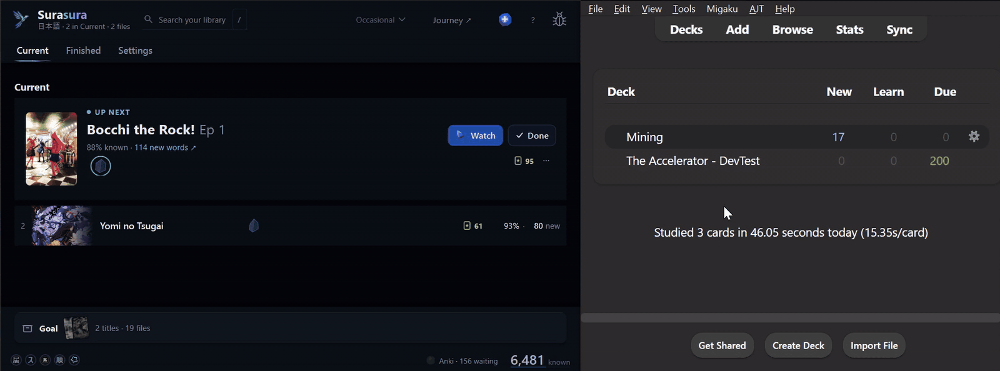
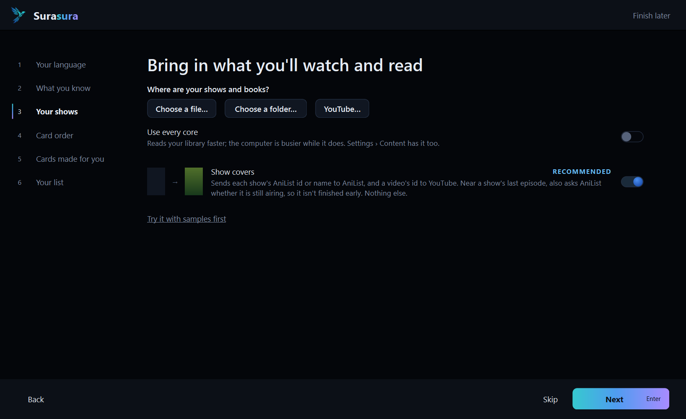
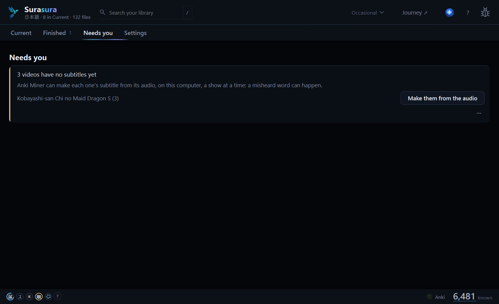

# Surasura 3.0.1 — safer saves, smoother cards

**A fix release for 3.0: your library stays out of Windows Defender's way, and your cards come quicker and more completely.**

[Download `Surasura-3.0.1-setup.exe`](#download) · [On 3.0.0?](#updating) · [Coming from 2.5?](#coming-from-25) · [What's new in 3.0](https://github.com/SonicSandbox/surasura/releases/tag/v3.0.0)

## 1 · Your library, safe from Defender 🛡️

| Where are your shows and books? | A blocked save says so |
| :---: | :---: |
|  |  |
| New installs keep the library in `C:\Users\<you>\Surasura`. | *Move my library* or *Allow Surasura in Windows Security*. |

With Windows Defender's **Controlled folder access** on, Windows could quietly stop Surasura saving into
**Documents**. New installs now keep the library outside it, and the installer says when Controlled folder access is
on. If Windows blocks a save, Surasura says so and offers **Move my library** (every file copied and checked before
the switch, one **Undo**) or **Allow Surasura in Windows Security**. **Your library is never moved without you**: an
existing one in Documents stays where it is and keeps working.

## 2 · Your cards, quicker and complete

| Mine an episode | Books and audiobooks too |
| :---: | :---: |
|  |  |
| A part Anki Miner failed on shows **Try again**. | Mining a book asks once for its audiobook. |

Finish a show and **Anki's order moves in seconds**. A card's reading matches the line as it's written. A card Anki
refuses no longer stops the rest: the word is named, and the part can be tried again.

## 3 · It tells you what it's doing

**Report a problem → Send report** now says when a send fails, and how many tries it took. Reports reach us again:
the receiver was fixed on 11 November, for 3.0.0 too.

## Before | Now

| | Before (3.0.0) | Now (3.0.1) |
| :-- | :-- | :-- |
| **Windows Defender** | With *Controlled folder access* on, Windows could quietly block saves into **Documents** | New installs keep the library in `C:\Users\<you>\Surasura`; a blocked save offers **Move my library** or **Allow Surasura in Windows Security** |
| **Finishing a show** | Anki's card order waited for the next Generate (13 s on a small library, almost 2 minutes on a big one) | Anki's order moves **in seconds** |
| **Mining a book** | A book with no audiobook paired made text-only cards without asking | It asks once for its audiobook: pick it, or mine without audio |
| **A part Anki Miner failed on** | Stuck: **Mine** said *Nothing to ask for* | It shows **Try again**, and a card Anki refuses no longer stops the rest; the word is named |
| **A card's reading** | Could differ from the line (a phrase's dictionary reading) | Matches the line as it's written (いい感じ → いいかんじ, 日本 → にほん) |
| **Send report** | A report could fail to send without a word | It says when a send fails and how many tries |
| **⋯ → Goal** | Could feel a little slow at high display scaling | Under 16 ms at every scale, up to 250 % |

Behind it: test-reliability fixes, so releases like this one ship sooner.

## Updating

**On 3.0.0?** Surasura offers 3.0.1 by itself: press **Update now**. It updates in place; your library, words and
settings stay as they are, and nothing is re-read.

## Coming from 2.5

1. Run **`Surasura-3.0.1-setup.exe`** (no admin needed). Your **known words, word lists and settings** come with you;
   your 2.5 folder is left exactly as it was.
2. Add your shows' and books' folders in setup — a 2.x tier keeps its place (NOW → Current, 6+ Months → Goal).
3. Your first Generate re-reads your library once. After that, the usual short ones.

Stop using 2.5 once 3.0 runs (the two could write the same files). Everything new in 3.0:
[the 3.0.0 notes](https://github.com/SonicSandbox/surasura/releases/tag/v3.0.0).

<b>Known limits</b>

- Cards are made in **Japanese only** for now; Chinese works everywhere else.
- **Desktop Anki must be open** for cards to be made and ordered.
- On a **very large library** (20,000+ files), the list can hitch for a moment as a new episode comes in.
- Windows only. The installer isn't signed: Windows may say *Windows protected your PC* → **More info** →
  **Run anyway**.

## Download

| Windows 10 or 11 | `Surasura-3.0.1-setup.exe` (below) |
| :-- | :-- |

The installer isn't signed: if Windows says *Windows protected your PC*, choose **More info → Run anyway**.

Surasura 3.0 is free software (GPL-3.0-or-later): its source is on [GitHub](https://github.com/SonicSandbox/surasura).
Every bundled library's licence text ships with it (`_internal\licenses`, listed in *Settings › App › Data credits*).

**Questions, ideas, bugs:** [the Surasura Discord](https://surasura.dev/app/discord) · **Report a problem** in the app ·
[the README](https://github.com/SonicSandbox/surasura#readme)
