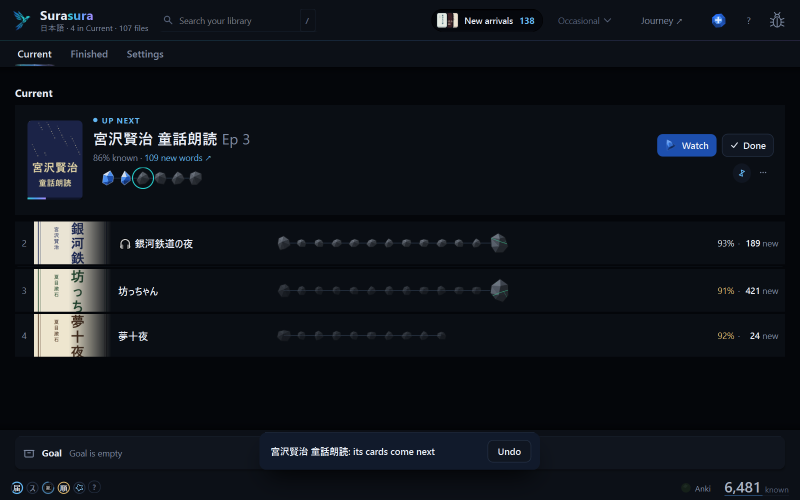

# Surasura 3.0.11 — practise what Anki knows, hear a line again

**Piyo practises your hardest cards and turns a round into something to listen to, a title's new words show on a
hover, and ▶ plays a line's own audio on a loop.**

[Download `Surasura-3.0.11-setup.exe`](#download) · [On 3.0.0 to 3.0.10?](#updating) · [Coming from 2.5?](#coming-from-25) · [What's new in 3.0](https://github.com/SonicSandbox/surasura/releases/tag/v3.0.0)

## What's better

- **Piyo practises from Anki:** your leeches (the cards you keep missing), today's cards, or the cards you know well.
- **Piyo listening rounds (Japanese):** a round becomes an mp3 with timed subtitles, plus a copy with pauses to answer
  in. Five voices to choose from. Needs the AI voice (beta).
- **Hover a title's *N new*** to see its new words, each with its sentence from that title.
- **▶ plays a line's own audio** in the journey, on a loop, with pause. *Settings › Play a line's own audio* turns it
  off.
- ***Nothing new to mine*:** a part with no new words says so, not *No cards in Anki* (which read like cards you deleted).
- **YouTube videos with only machine captions** get their cards from Anki Miner's own transcription of the audio (when
  its speech model is installed); without one, from the captions, with one note saying so.
- **A video with no subtitle track inside** (a BD rip, say): its subtitle file is timed against the video's own
  speech, for Japanese, when Anki Miner's speech files are installed.

**Fixes:** an audiobook's transcript is checked again after an update; 順's footer finds an audiobook's and a single
video's cards; a video dropped straight into Processed is titled by its channel.

Thanks to **Mattias** for the ideas behind these: the transcript re-check (#432), 順's footer sources (#447), the
Processed title (#449), *Nothing new to mine* (#454), cards from machine-captioned videos (#455) and timing against a
video's own speech (#452, Tsubasa-sync #4).

## Before | Now

| | Before (3.0.10) | Now (3.0.11) |
| :-- | :-- | :-- |
| **Piyo's rounds** | Words from your library | + your leeches, today's cards, well-known cards |
| **A title's new words** | A number | The words and their sentences, on a hover |
| **A line's audio** | The episode | ▶ the line itself, looped |
| **A part with nothing new** | *No cards in Anki* | *Nothing new to mine* |
| **A video with no subtitle track** | Its timing couldn't be checked | Checked against its speech (Japanese) |

## Updating

**On 3.0.0 to 3.0.10?** Surasura offers 3.0.11 by itself: press **Update now**. It updates in place; your library,
words and settings stay as they are.

**Piyo's helper running from 3.0.7 or earlier** still holds this one update: the update window asks you to **Stop it**
once. From 3.0.8 on, it steps aside by itself.

## Coming from 2.5

1. Run **`Surasura-3.0.11-setup.exe`** (no admin needed). Your **known words, word lists and settings** come with you;
   your 2.5 folder is left exactly as it was.
2. Add your shows' and books' folders in setup — a 2.x tier keeps its place (NOW → Current, 6+ Months → Goal).
3. Your first Generate re-reads your library once. After that, the usual short ones.

Stop using 2.5 once 3.0 runs (the two could write the same files). Everything new in 3.0:
[the 3.0.0 notes](https://github.com/SonicSandbox/surasura/releases/tag/v3.0.0) · what came since:
[3.0.1](https://github.com/SonicSandbox/surasura/releases/tag/v3.0.1) ·
[3.0.2](https://github.com/SonicSandbox/surasura/releases/tag/v3.0.2) ·
[3.0.3](https://github.com/SonicSandbox/surasura/releases/tag/v3.0.3) ·
[3.0.4](https://github.com/SonicSandbox/surasura/releases/tag/v3.0.4) ·
[3.0.5](https://github.com/SonicSandbox/surasura/releases/tag/v3.0.5) ·
[3.0.6](https://github.com/SonicSandbox/surasura/releases/tag/v3.0.6) ·
[3.0.7](https://github.com/SonicSandbox/surasura/releases/tag/v3.0.7) ·
[3.0.8](https://github.com/SonicSandbox/surasura/releases/tag/v3.0.8) ·
[3.0.9](https://github.com/SonicSandbox/surasura/releases/tag/v3.0.9) ·
[3.0.10](https://github.com/SonicSandbox/surasura/releases/tag/v3.0.10).

<b>Known limits</b>

- **Desktop Anki must be open** for cards to be made and ordered. Chinese cards need Anki Miner 3.12 or later.
- **Listening rounds** are Japanese only, and need the AI voice (beta) installed.
- On a **very large library** (20,000+ files), the list can hitch for a moment as a new episode comes in.
- Windows only. The installer isn't signed: Windows may say *Windows protected your PC* → **More info** →
  **Run anyway**.

## Download

| Windows 10 or 11 | `Surasura-3.0.11-setup.exe` (below) |
| :-- | :-- |

The installer isn't signed: if Windows says *Windows protected your PC*, choose **More info → Run anyway**.

Surasura 3.0 is free software (GPL-3.0-or-later): its source is on [GitHub](https://github.com/SonicSandbox/surasura).
Every bundled library's licence text ships with it (`_internal\licenses`, listed in *Settings › App › Data credits*).

**Questions, ideas, bugs:** [the Surasura Discord](https://surasura.dev/app/discord) · **Report a problem** in the app ·
[the README](https://github.com/SonicSandbox/surasura#readme)
