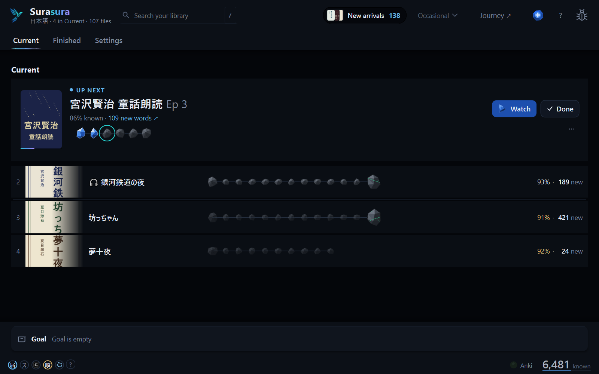

# Surasura 3.0.15 — episodes in order, a quicker side by side

**A show's new episodes keep their order in Current, side by side stays quick on a big library, and Anki Miner 3.13
makes better cards.**

[Download `Surasura-3.0.15-setup.exe`](#download) · [On 3.0.0 to 3.0.14?](#updating) · [Coming from 2.5?](#coming-from-25) · [What's new in 3.0](https://github.com/SonicSandbox/surasura/releases/tag/v3.0.0)

## What's better

- **A show's new episodes keep episode order:** bring them into Current one at a time (a weekly episode, a season
  that arrives episode by episode) and they join their show in order, 8, 9, 10, instead of stacking on top.
- **Side by side stays quick on a big library:** dropping a row no longer stalls with a thousand titles, and the
  window shows the same two titles Anki takes turns with (*Settings › Anki & mining › New cards come from*).
- **Anki Miner 3.13:** book cards hold exactly the right sentence, and Chinese cards get their measure word.
  Surasura installs 3.13 and offers it if you're on an older one.
- **A line said twice in a clip shows once in the card** (with Anki Miner 3.13).

Thanks to **Mattias** for the idea behind the episode-order fix.

## Before | Now

| | Before (3.0.14) | Now (3.0.15) |
| :-- | :-- | :-- |
| **A show's episodes moved into Current one by one** | 10, 9, 8 | 8, 9, 10 |
| **A drop with side by side on, 1,000 titles** | About 1.4 s | About 0.03 s |
| **The two titles side by side** | The window and Anki could pick different ones | The same two |
| **A book card's sentence** | Could be the whole quoted speech | The one sentence |
| **A Chinese card's measure word** | Empty | Filled |
| **A line said twice in a card's clip** | Twice in its sentence | Once |

## Updating

**On 3.0.0 to 3.0.14?** Surasura offers 3.0.15 by itself: press **Update now**. It updates in place; your library,
words and settings stay as they are.

**Piyo's helper running from 3.0.7 or earlier** still holds this one update: the update window asks you to **Stop it**
once. From 3.0.8 on, it steps aside by itself.

## Coming from 2.5

1. Run **`Surasura-3.0.15-setup.exe`** (no admin needed). Your **known words, word lists and settings** come with you;
   your 2.5 folder is left exactly as it was.
2. Add your shows' and books' folders in setup — a 2.x tier keeps its place (NOW → Current, 6+ Months → Goal).
3. Your first Generate re-reads your library once. After that, the usual short ones.

Stop using 2.5 once 3.0 runs (the two could write the same files). Everything new in 3.0:
[the 3.0.0 notes](https://github.com/SonicSandbox/surasura/releases/tag/v3.0.0) · what came since:
[3.0.1](https://github.com/SonicSandbox/surasura/releases/tag/v3.0.1) ·
[3.0.2](https://github.com/SonicSandbox/surasura/releases/tag/v3.0.2) ·
[3.0.3](https://github.com/SonicSandbox/surasura/releases/tag/v3.0.3) ·
[3.0.4](https://github.com/SonicSandbox/surasura/releases/tag/v3.0.4) ·
[3.0.5](https://github.com/SonicSandbox/surasura/releases/tag/v3.0.5) ·
[3.0.6](https://github.com/SonicSandbox/surasura/releases/tag/v3.0.6) ·
[3.0.7](https://github.com/SonicSandbox/surasura/releases/tag/v3.0.7) ·
[3.0.8](https://github.com/SonicSandbox/surasura/releases/tag/v3.0.8) ·
[3.0.9](https://github.com/SonicSandbox/surasura/releases/tag/v3.0.9) ·
[3.0.10](https://github.com/SonicSandbox/surasura/releases/tag/v3.0.10) ·
[3.0.11](https://github.com/SonicSandbox/surasura/releases/tag/v3.0.11) ·
[3.0.12](https://github.com/SonicSandbox/surasura/releases/tag/v3.0.12) ·
[3.0.13](https://github.com/SonicSandbox/surasura/releases/tag/v3.0.13) ·
[3.0.14](https://github.com/SonicSandbox/surasura/releases/tag/v3.0.14).

<b>Known limits</b>

- **Desktop Anki must be open** for cards to be made and ordered. Chinese cards need Anki Miner 3.12 or later.
- **Listening rounds** are Japanese only, and need the AI voice (beta) installed.
- On a **very large library** (20,000+ files), the list can hitch for a moment as a new episode comes in.
- Windows only. The installer isn't signed: Windows may say *Windows protected your PC* → **More info** →
  **Run anyway**.

## Download

| Windows 10 or 11 | `Surasura-3.0.15-setup.exe` (below) |
| :-- | :-- |

The installer isn't signed: if Windows says *Windows protected your PC*, choose **More info → Run anyway**.

Surasura 3.0 is free software (GPL-3.0-or-later): its source is on [GitHub](https://github.com/SonicSandbox/surasura).
Every bundled library's licence text ships with it (`_internal\licenses`, listed in *Settings › App › Data credits*).

**Questions, ideas, bugs:** [the Surasura Discord](https://surasura.dev/app/discord) · **Report a problem** in the app ·
[the README](https://github.com/SonicSandbox/surasura#readme)
