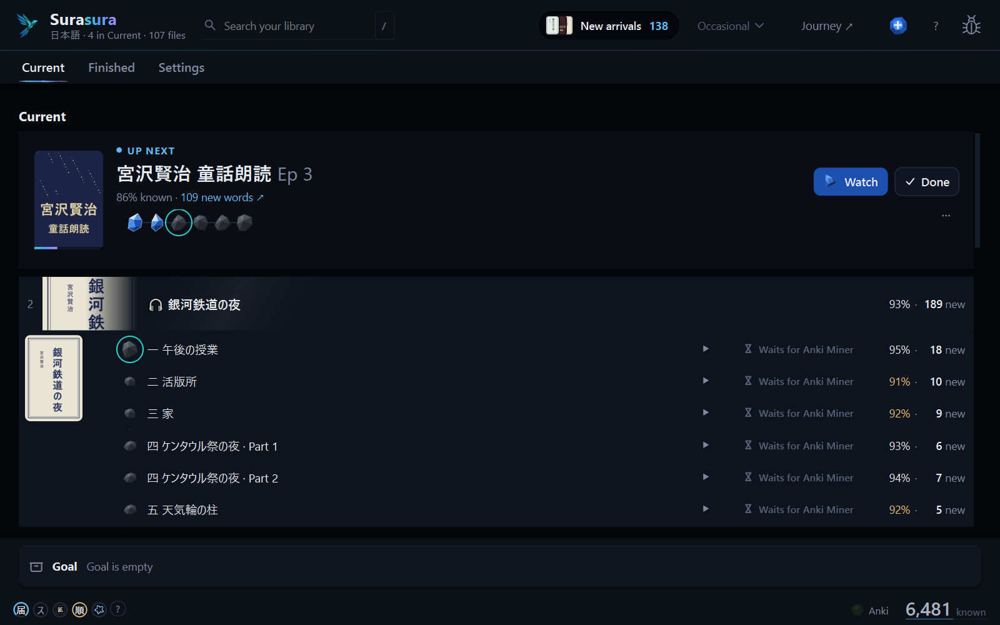
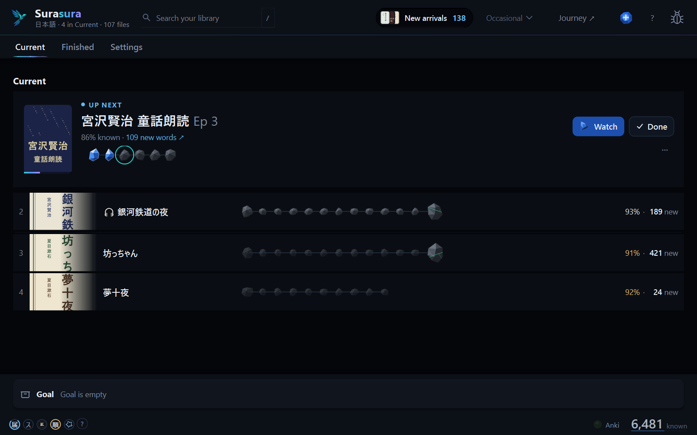
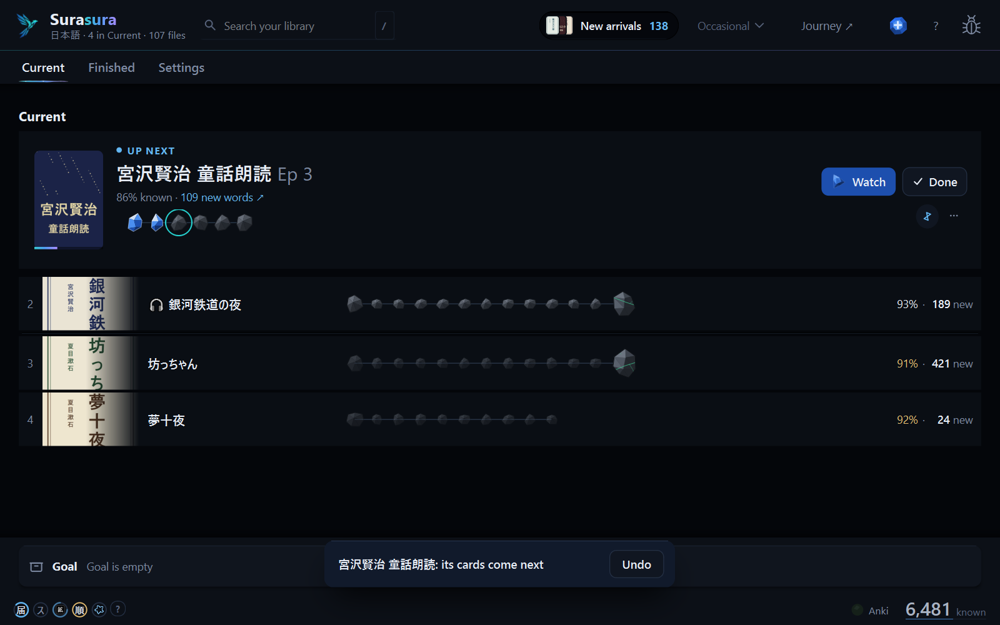
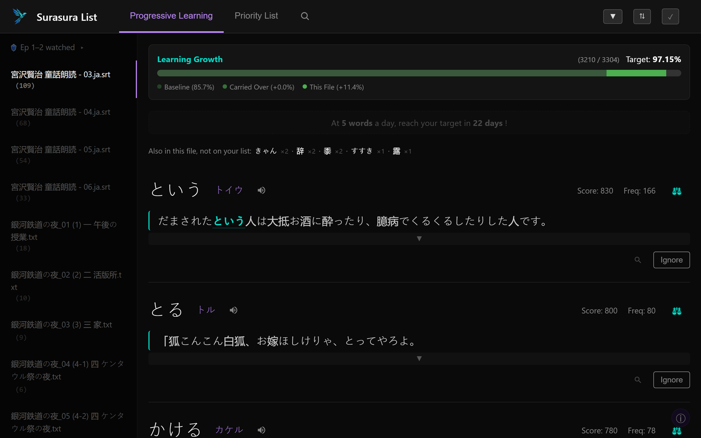

# Surasura 3.0.2 — the right cover, the right results

**A fix release for 3.0: books show their own covers, search shows its shows, and Surasura finds what you point it at.**

[Download `Surasura-3.0.2-setup.exe`](#download) · [On 3.0.0 or 3.0.1?](#updating) · [Coming from 2.5?](#coming-from-25) · [What's new in 3.0](https://github.com/SonicSandbox/surasura/releases/tag/v3.0.0)

## 1 · Your books and shows, as they are

| Your library, in your order | Books and audiobooks too |
| :---: | :---: |
|  |  |
| Search (`/` or Ctrl+K) shows the shows it finds. | A book shows the cover it declares. |

A book now shows **its own cover**, the one the book itself names (a wrong one from 3.0.0 is replaced on the next
look). **Search** shows every show and book it finds under its group, at any window size. An anime's videos are found
when you pick them by hand or press **Find videos**, and its episodes pair with them.

## 2 · Your cards, and the words between them

| Mine an episode | The words worth learning next |
| :---: | :---: |
|  |  |
| A part that fails again names the word Anki refused. | Piyo's *soon* words are the journey's. |

A part Anki Miner fails on again says **which word Anki refused**, and **Report a problem → Send report** carries it
(the word and Anki's reason, never your sentence). **Piyo ぴよ**'s *soon* words follow the **Journey ↗**: the words you
meet next, in its order.

## 3 · It finds hato wherever it is

Subtitles from hato: Surasura now finds hato wherever it's installed, and **Find hato…** points it at a copy it
couldn't see.

## Before | Now

| | Before (3.0.1) | Now (3.0.2) |
| :-- | :-- | :-- |
| **A book's cover** | Often a picture merely *named* cover (sometimes the back) | The cover the book itself declares |
| **Search** | Could show the group names (CURRENT, GOAL) with no shows under them | Every show and book it finds |
| **An anime's videos** | Not found, even picked by hand or after **Find videos** | Found, and the episodes pair with them |
| **hato** | Not seen when installed somewhere Surasura didn't look | Found wherever it is; **Find hato…** for the rest |
| **A part that fails again** | Said it failed | Names the word Anki refused; a report carries it |
| **Try again** | Retried a word at a time, slowly; on a book an old *Try again* could hide a newer *No video* | Quicker word-at-a-time retries; a book's row shows its newest state |
| **Piyo's *soon*** | Your list's order | The journey's: the words you meet next |

## Updating

**On 3.0.0 or 3.0.1?** Surasura offers 3.0.2 by itself: press **Update now**. It updates in place; your library,
words and settings stay as they are.

## Coming from 2.5

1. Run **`Surasura-3.0.2-setup.exe`** (no admin needed). Your **known words, word lists and settings** come with you;
   your 2.5 folder is left exactly as it was.
2. Add your shows' and books' folders in setup — a 2.x tier keeps its place (NOW → Current, 6+ Months → Goal).
3. Your first Generate re-reads your library once. After that, the usual short ones.

Stop using 2.5 once 3.0 runs (the two could write the same files). Everything new in 3.0:
[the 3.0.0 notes](https://github.com/SonicSandbox/surasura/releases/tag/v3.0.0) · what 3.0.1 fixed:
[the 3.0.1 notes](https://github.com/SonicSandbox/surasura/releases/tag/v3.0.1).

<b>Known limits</b>

- Cards are made in **Japanese only** for now; Chinese works everywhere else.
- **Desktop Anki must be open** for cards to be made and ordered.
- On a **very large library** (20,000+ files), the list can hitch for a moment as a new episode comes in.
- Windows only. The installer isn't signed: Windows may say *Windows protected your PC* → **More info** →
  **Run anyway**.

## Download

| Windows 10 or 11 | `Surasura-3.0.2-setup.exe` (below) |
| :-- | :-- |

The installer isn't signed: if Windows says *Windows protected your PC*, choose **More info → Run anyway**.

Surasura 3.0 is free software (GPL-3.0-or-later): its source is on [GitHub](https://github.com/SonicSandbox/surasura).
Every bundled library's licence text ships with it (`_internal\licenses`, listed in *Settings › App › Data credits*).

**Questions, ideas, bugs:** [the Surasura Discord](https://surasura.dev/app/discord) · **Report a problem** in the app ·
[the README](https://github.com/SonicSandbox/surasura#readme)
