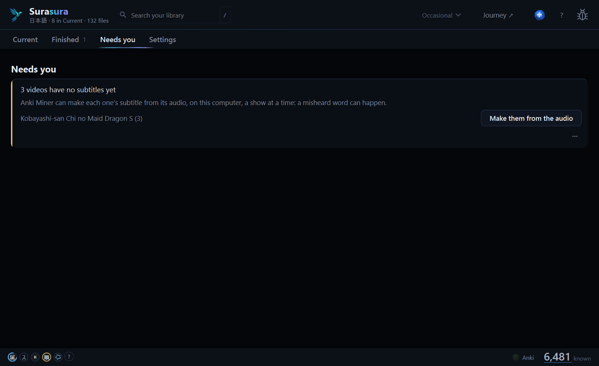

# Surasura 3.0.3 — every card through, nothing left running

**A fix release for 3.0: a word Anki won't take no longer holds up a part, a subtitle you fixed is seen, and Surasura's helpers close when you close it.**

[Download `Surasura-3.0.3-setup.exe`](#download) · [On 3.0.0 to 3.0.2?](#updating) · [Coming from 2.5?](#coming-from-25) · [What's new in 3.0](https://github.com/SonicSandbox/surasura/releases/tag/v3.0.0)

## 1 · Every card through

| One card for each decision | Mine an episode |
| :---: | :---: |
|  |  |
| A word Anki refuses: **Skip this word**. | Not timed? Fix it, then **Check again**. |

When Anki refuses a word, **Needs you** names it and says why, and **Skip this word** leaves it out: the rest of the
part's cards are made, and that word is never asked again. The usual cause is a dictionary's example text that looks
like a cloze card to Anki; the names Surasura itself puts on a card never can.

An episode marked **Not timed** now sees a subtitle you re-timed beside its video (where tsubasa saves one), and
**Check again** on its row checks its timing straight away.

## 2 · It closes when you do

Close Surasura and its helpers close too: no `surasura-cli.exe` left waiting in the background for hours. What was
waiting is picked up again the next time you open it. **Settings › Open Anki Miner** says *Anki Miner is already
open.* instead of starting a second copy.

Setup's last step tells you what to do when there's nothing to count yet (**Add a show first**, or sort one out of
**New arrivals** into **Current**), instead of *Counting your shows…* for good.

## 3 · Ready for hato's subtitles from the audio

A subtitle hato makes from an episode's audio (hato's next version) is read as that episode's, and its cards carry
the tag `surasura::from-audio`.

## Before | Now

| | Before (3.0.2) | Now (3.0.3) |
| :-- | :-- | :-- |
| **A word Anki refuses** | Named; the part stayed failed | Named, with why, and **Skip this word**; the rest of its cards are made |
| **A subtitle you re-timed** | Not seen: the episode stayed *Not timed* | Seen beside its video; **Check again** on its row |
| **After you close Surasura** | `surasura-cli.exe` could stay running for hours | Its helpers close with it |
| **Open Anki Miner, twice** | A second copy | *Anki Miner is already open.* |
| **Setup on an empty library** | *Counting your shows…* for good | Says what to add first |
| **Removed's *Bring back*** | Could be missing while the library was busy | Shown once the library answers |
| **Report a problem, on a short screen** | Could reach past the screen's bottom | Stays on the screen, and scrolls |

## Updating

**On 3.0.0, 3.0.1 or 3.0.2?** Surasura offers 3.0.3 by itself: press **Update now**. It updates in place; your
library, words and settings stay as they are.

## Coming from 2.5

1. Run **`Surasura-3.0.3-setup.exe`** (no admin needed). Your **known words, word lists and settings** come with you;
   your 2.5 folder is left exactly as it was.
2. Add your shows' and books' folders in setup — a 2.x tier keeps its place (NOW → Current, 6+ Months → Goal).
3. Your first Generate re-reads your library once. After that, the usual short ones.

Stop using 2.5 once 3.0 runs (the two could write the same files). Everything new in 3.0:
[the 3.0.0 notes](https://github.com/SonicSandbox/surasura/releases/tag/v3.0.0) · what came since:
[3.0.1](https://github.com/SonicSandbox/surasura/releases/tag/v3.0.1) ·
[3.0.2](https://github.com/SonicSandbox/surasura/releases/tag/v3.0.2).

<b>Known limits</b>

- Cards are made in **Japanese only** for now; Chinese works everywhere else.
- **Desktop Anki must be open** for cards to be made and ordered.
- On a **very large library** (20,000+ files), the list can hitch for a moment as a new episode comes in.
- Windows only. The installer isn't signed: Windows may say *Windows protected your PC* → **More info** →
  **Run anyway**.

## Download

| Windows 10 or 11 | `Surasura-3.0.3-setup.exe` (below) |
| :-- | :-- |

The installer isn't signed: if Windows says *Windows protected your PC*, choose **More info → Run anyway**.

Surasura 3.0 is free software (GPL-3.0-or-later): its source is on [GitHub](https://github.com/SonicSandbox/surasura).
Every bundled library's licence text ships with it (`_internal\licenses`, listed in *Settings › App › Data credits*).

**Questions, ideas, bugs:** [the Surasura Discord](https://surasura.dev/app/discord) · **Report a problem** in the app ·
[the README](https://github.com/SonicSandbox/surasura#readme)
