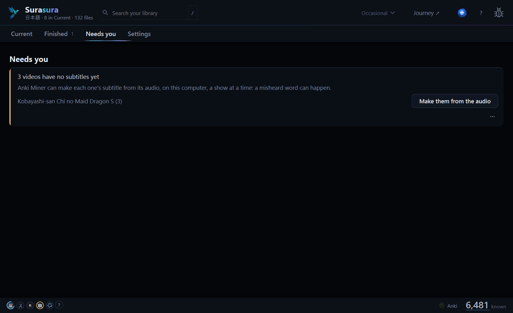

# Surasura 3.0.4 — Chinese cards, and books get their voice

**Connect now makes Chinese cards, a book with its audiobook gets its sentences' audio, and a card from a cut episode never plays the wrong scene.**

[Download `Surasura-3.0.4-setup.exe`](#download) · [On 3.0.0 to 3.0.3?](#updating) · [Coming from 2.5?](#coming-from-25) · [What's new in 3.0](https://github.com/SonicSandbox/surasura/releases/tag/v3.0.0)

## 1 · Chinese cards

Connect makes cards for your **Chinese** library too: pinyin with its tone colours, the sentence's audio and picture,
through Anki Miner 3.12. Setup offers the **Anki Miner Note** first, or map your own note type field by field (it's
checked before anything is written). **Word audio from Google** is a switch, off by default: off, no word is sent
anywhere.

A Chinese video with no subtitle can go to **hato** (1.3 or later), which looks on assrt.net, then OpenSubtitles, with
your own keys — after the Chinese library's own **Find them with hato**.

## 2 · Books and their audiobooks

| A book, with its chapters | One card for each decision |
| :---: | :---: |
|  |  |
| An audiobook's own subtitle lines its book up. | A book card's sentence is the one that holds the word. |

- An audiobook that comes with its own timed `.srt` lines up its book straight away — no hours of listening first.
- A book card's sentence is the sentence that holds the word (not a whole page-long speech), within your **Length**.
- Book cards made text-only can get the narrator's own audio, into an empty audio field only (for now from the
  command line: `surasura-cli add-audio --book <the book>` shows what it would do, `--confirm` does it; one Undo).
- **AI audio for cards without audio (beta, Japanese):** an optional voice, off by default — **Settings › App › Beta**
  installs it on your press. It then runs on your PC only: your sentences never leave it.

## 3 · Cleaner cards

- An episode whose subtitle shifts part-way (another broadcast's cut) is re-timed by tsubasa itself — no fix by hand.
- A line in the stretch around a cut where the timing is unsure never makes a card (tsubasa 0.1.12): the word takes
  another line, or waits.
- という at a line's end runs on to the next line when that line holds what it names; an unknown name like 犍陀多 is
  one word.
- **順 Junban:** a reorder you start finishes an automatic one that was cut off, instead of asking for Undo first. One
  Undo puts back both.
- **Piyo** (the practice chat in your own AI app) can now help with Surasura itself: how-to answers from this
  version's guide, a read-only *what's wrong* look, and a report you send from the window.

## Before | Now

| | Before (3.0.3) | Now (3.0.4) |
| :-- | :-- | :-- |
| **Chinese cards** | Waited: Japanese only | Made, with pinyin and audio (Anki Miner 3.12) |
| **A Chinese video without subtitles** | Never handed to hato | hato 1.3 finds them, on your yes |
| **An audiobook with its own subtitle** | Waited for a long listen | Lines its book up at once |
| **A book card's sentence** | Could be a whole long speech | The sentence that holds the word, within your Length |
| **Book cards made without audio** | Stayed silent | The narrator's clip, or the AI voice (beta) |
| **A subtitle that shifts part-way** | *Not timed* until you fixed it | Re-timed by tsubasa |
| **A line near a cut** | Could play the next scene | Never made into a card |
| **Junban after a cut-off automatic reorder** | Refused until you pressed Undo | Your reorder finishes it |

## Updating

**On 3.0.0 to 3.0.3?** Surasura offers 3.0.4 by itself: press **Update now**. It updates in place; your library,
words and settings stay as they are. Your first Generate after it re-reads your library once (the word rules
changed); after that, the usual short ones. Connect offers Anki Miner 3.12 (Chinese cards need it).

## Coming from 2.5

1. Run **`Surasura-3.0.4-setup.exe`** (no admin needed). Your **known words, word lists and settings** come with you;
   your 2.5 folder is left exactly as it was.
2. Add your shows' and books' folders in setup — a 2.x tier keeps its place (NOW → Current, 6+ Months → Goal).
3. Your first Generate re-reads your library once. After that, the usual short ones.

Stop using 2.5 once 3.0 runs (the two could write the same files). Everything new in 3.0:
[the 3.0.0 notes](https://github.com/SonicSandbox/surasura/releases/tag/v3.0.0) · what came since:
[3.0.1](https://github.com/SonicSandbox/surasura/releases/tag/v3.0.1) ·
[3.0.2](https://github.com/SonicSandbox/surasura/releases/tag/v3.0.2) ·
[3.0.3](https://github.com/SonicSandbox/surasura/releases/tag/v3.0.3).

<b>Known limits</b>

- **Desktop Anki must be open** for cards to be made and ordered. Chinese cards need Anki Miner 3.12 or later.
- On a **very large library** (20,000+ files), the list can hitch for a moment as a new episode comes in.
- Windows only. The installer isn't signed: Windows may say *Windows protected your PC* → **More info** →
  **Run anyway**.

## Download

| Windows 10 or 11 | `Surasura-3.0.4-setup.exe` (below) |
| :-- | :-- |

The installer isn't signed: if Windows says *Windows protected your PC*, choose **More info → Run anyway**.

Surasura 3.0 is free software (GPL-3.0-or-later): its source is on [GitHub](https://github.com/SonicSandbox/surasura).
Every bundled library's licence text ships with it (`_internal\licenses`, listed in *Settings › App › Data credits*).

**Questions, ideas, bugs:** [the Surasura Discord](https://surasura.dev/app/discord) · **Report a problem** in the app ·
[the README](https://github.com/SonicSandbox/surasura#readme)
