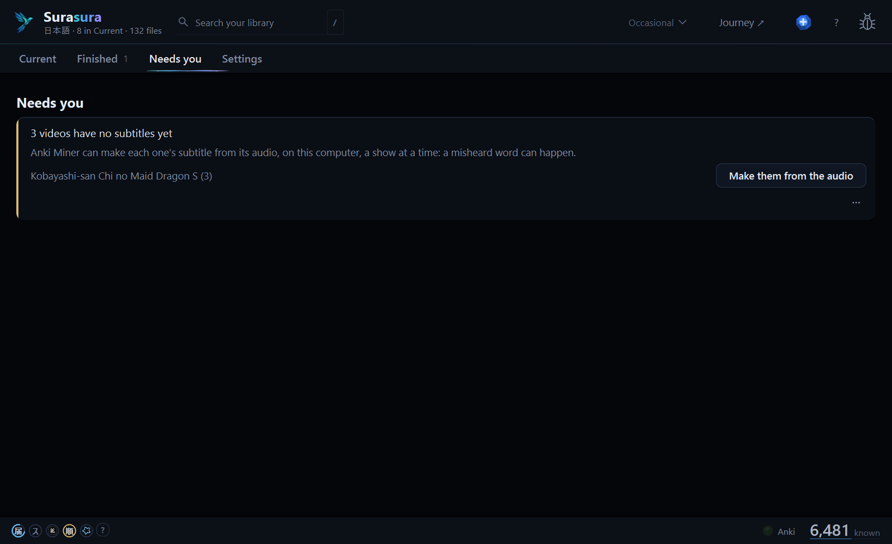

# Surasura 3.0.5 — Anki's busy moments, and the narrator's voice from the window

**A busy Anki is waited for, not reported as a failure, and books you mined before their audiobook can get the narrator's voice with one press.**

[Download `Surasura-3.0.5-setup.exe`](#download) · [On 3.0.0 to 3.0.4?](#updating) · [Coming from 2.5?](#coming-from-25) · [What's new in 3.0](https://github.com/SonicSandbox/surasura/releases/tag/v3.0.0)

## 1 · Anki busy is a wait

Anki sometimes says *busy* (a sync, Check Database, a card answered while Surasura asks). Surasura now waits and tries
again:

- **順 Junban** and **Backfill** wait for the next chance quietly; cards Anki was too busy to take wait for the next
  re-order instead of counting as failed.
- Anki's sync no longer shows *AnkiWeb: sync failed* when Anki was only busy.
- The re-plan says *Anki isn't answering just now — trying again shortly*, then tries again.
- Connect says *Waiting for Anki: it's busy.*

## 2 · The narrator's voice for books mined before their audiobook

| A book, with its chapters | One card for each decision |
| :---: | :---: |
|  |  |
| A book's ⋯ menu offers it any time. | *Needs you* offers it once, for each book. |

- A book whose cards were made text-only, and that now has its audiobook, gets **one** *Needs you* line:
  **Add the narrator's voice**. The book row's ⋯ menu has it too.
- Only an empty sentence-audio field is filled; nothing else on the card changes and your reviews stay. One **Undo**
  takes it back.
- A book not lined up with its audiobook yet is lined up first, as its own job you can see and stop.

## 3 · Smaller things

- hato's searches for subtitles run on their own, so a long hato wait no longer holds up copying the next video's own
  subtitle track.
- The installer now carries the notices of the libraries Qt builds in (in `_internal\licenses`).

## Before | Now

| | Before (3.0.4) | Now (3.0.5) |
| :-- | :-- | :-- |
| **Anki busy (a sync, a review)** | Junban / Backfill skipped with *Anki refused*; *sync failed* | A short wait, then they try again |
| **Book cards mined before the audiobook** | The narrator's voice from the command line only | One press in *Needs you* or the book's ⋯ |
| **A long hato search** | Held up the next subtitle track copy | Runs on its own |

## Updating

**On 3.0.0 to 3.0.4?** Surasura offers 3.0.5 by itself: press **Update now**. It updates in place; your library,
words and settings stay as they are.

## Coming from 2.5

1. Run **`Surasura-3.0.5-setup.exe`** (no admin needed). Your **known words, word lists and settings** come with you;
   your 2.5 folder is left exactly as it was.
2. Add your shows' and books' folders in setup — a 2.x tier keeps its place (NOW → Current, 6+ Months → Goal).
3. Your first Generate re-reads your library once. After that, the usual short ones.

Stop using 2.5 once 3.0 runs (the two could write the same files). Everything new in 3.0:
[the 3.0.0 notes](https://github.com/SonicSandbox/surasura/releases/tag/v3.0.0) · what came since:
[3.0.1](https://github.com/SonicSandbox/surasura/releases/tag/v3.0.1) ·
[3.0.2](https://github.com/SonicSandbox/surasura/releases/tag/v3.0.2) ·
[3.0.3](https://github.com/SonicSandbox/surasura/releases/tag/v3.0.3) ·
[3.0.4](https://github.com/SonicSandbox/surasura/releases/tag/v3.0.4).

<b>Known limits</b>

- **Desktop Anki must be open** for cards to be made and ordered. Chinese cards need Anki Miner 3.12 or later.
- On a **very large library** (20,000+ files), the list can hitch for a moment as a new episode comes in.
- Windows only. The installer isn't signed: Windows may say *Windows protected your PC* → **More info** →
  **Run anyway**.

## Download

| Windows 10 or 11 | `Surasura-3.0.5-setup.exe` (below) |
| :-- | :-- |

The installer isn't signed: if Windows says *Windows protected your PC*, choose **More info → Run anyway**.

Surasura 3.0 is free software (GPL-3.0-or-later): its source is on [GitHub](https://github.com/SonicSandbox/surasura).
Every bundled library's licence text ships with it (`_internal\licenses`, listed in *Settings › App › Data credits*).

**Questions, ideas, bugs:** [the Surasura Discord](https://surasura.dev/app/discord) · **Report a problem** in the app ·
[the README](https://github.com/SonicSandbox/surasura#readme)
